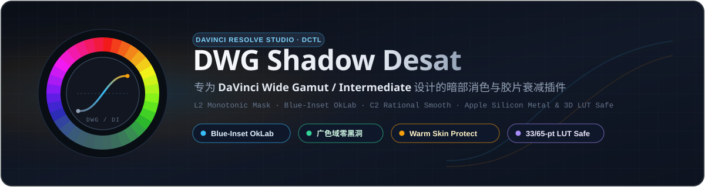
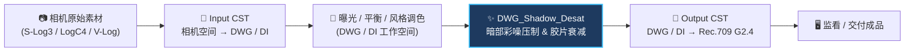

<div align="center">



<br />

[](DWG_Shadow_Desat.dctl)
[](#-安装方法)
[](#%EF%B8%8F-%E6%8E%A8%E8%8D%90%E8%8A%82%E7%82%B9%E6%A0%91%E4%B8%8E%E8%89%B2%E5%BD%A9%E7%AE%A1%E7%BA%BF)
[](#-%E6%A0%B8%E5%BF%83%E5%8E%9F%E7%90%86%E4%B8%8E%E5%8F%AF%E8%A7%86%E5%8C%96)
[](#-%E9%85%8D%E5%90%88%E8%BE%BE%E8%8A%AC%E5%A5%87%E7%94%9F%E6%88%90-lut%E7%9A%84%E6%93%8D%E4%BD%9C%E8%A7%84%E8%8C%83)
[](#-%E8%87%AA%E5%8A%A8%E5%8C%96%E9%AA%8C%E8%AF%81%E4%B8%8E%E6%B5%8B%E8%AF%95%E5%8D%A1)

<p align="center">
  <strong>专精于 DaVinci Wide Gamut / DaVinci Intermediate (DWG / DI) 的暗部降饱和 DCTL 插件</strong><br />
  兼顾 <strong>高 ISO 暗部彩噪压制</strong> 与 <strong>胶片暗部自然色彩衰减</strong> · 严格中性灰（含 Sub-black）零漂移 · 真正 C² 平滑过渡 · Apple Silicon Metal 专项加固 · 3D LUT 导出安全
</p>

[效果对比](#-效果对比16-bit-dwgdi-专项测试卡) ·
[原理可视化](#-核心原理与可视化) ·
[节点管线](#%EF%B8%8F-推荐节点树与色彩管线) ·
[安装指南](#-安装方法) ·
[参数详解](#%EF%B8%8F-参数详解8-个核心控件) ·
[参考预设](#-三套实用参考预设) ·
[LUT 导出规范](#-配合达芬奇生成-lut的操作规范) ·
[项目结构](#-项目文件结构)

</div>

---


针对达芬奇原生 `Lum vs Sat` 在广色域下容易出现的 **“越降越暗 / 越降越亮”**、**“蓝偏紫 / 红偏粉”**、**“黑位绿噪变白麻点”** 以及 **“33 点 3D LUT 导出断层”** 等痛点，本插件从底层色彩科学重新构建：

| 痛点维度 | 达芬奇原生 `Lum vs Sat` | `DWG_Shadow_Desat.dctl` |
| :--- | :--- | :--- |
| 🎯 **暗部色相稳定性 (Abney 效应)** | 线性或传统圆柱饱和度收缩时，蓝色易偏紫、红色易偏粉 | 内置 **Blue-Inset OkLab** 引擎，沿人眼感知等色相线径向收敛且 `[0, 1]³` 严格非负 |
| 🛡️ **DWG 广色域黑洞防护** | DWG CIE 亮度权重中蓝色为负 (`-0.14775`)，高饱和蓝紫/青色极易掉进负亮度并撕裂出 V 型黑洞 | **全正定 $L_2$ 单调暗部遮罩** + **蓝原色 Inset (`aB = 0.32`) 全正定 OkLab 引擎**，彻底杜绝 S-Log3/DWG 高饱和蓝紫黑洞与通道倒挂 |
| 🎞️ **黑位彩噪与 Sub-black 稳定性** | 绿色/品红彩噪消色后常变“亮白麻点”；负黑位信号易被暴力裁平 | **Chroma Density** 仅对有色像素做密度补偿，**含 Sub-black ($R=G=B<0$) 在内的全区间中性灰绝对 0 漂移** |
| 🔥 **跨曝光背光暖肤色保留** | 一刀切抽干阴影，或保护力度随暗部亮度下降而意外失效 | **Warm Skin Protect** 采用亮度自适应相对色度软核，在极暗背光区仍恒定护住暖肤血气 |
| 🍎 **Apple Silicon Metal 与 3D LUT 安全** | 曲线过陡易漏采断层；Metal `-ffast-math` 下幂/开方零边界易生 `NaN` | **有理 Schlick + 五次 `smooth5` 真正 $C^2$ 曲线**、**Metal 零 `NaN` 防护**、**SIMD 中高光提前剪枝**、**`0.095 ~ 0.15` 动态跨度保护** |

---

## 🖼️ 效果对比（16-bit DWG/DI 专项测试卡）

使用仓库内置的真 16-bit 测试卡 [`DWG_DI_Shadow_Desat_TestChart_16bit.png`](DWG_DI_Shadow_Desat_TestChart_16bit.png) 经 `DWG/DI → Rec.709 Gamma 2.4` 转换后的四宫格实测对比：

<p align="center">
  
</p>

- **① Original**：包含中性灰阶梯、7 色暗部渐变条、高强度暗部彩噪矩阵（绿噪 / DWG 极限蓝 / 品红青噪 / 近零黑位）、暖肤色球 vs 冷蓝球，以及内圈 `-3EV` / 外圈未处理等亮色轮。
- **② Film Rolloff Preset (`OkLab`, `Strength=0.85`, `Warm Protect=0.20`)**：左下角各类暗部彩噪矩阵被温和压平融入黑位，中灰 (`0.336`) 与高光区与原图保持像素级一致。
- **③ Highlight Preview (`Warm Skin Protect=0.80`)**：直观高亮显示受影响的暗部选区——受保护的中灰以上区域与暖肤色球/色轮暖色扇区被压为 18% 中灰。
- **④ Shadow Mask Preview (`Strength=0.85`, `Warm Skin Protect=0.80`)**：经 Rec.709 G2.4 SDR 逆显示映射后精确呈现 `0% ~ 100% IRE` 无裁切消色遮罩，暖肤色区域平滑避让，过渡斜率与冷色噪声压制清晰可辨。

---

## 📐 核心原理与可视化

### 1. DI 编码域有理 $C^2$ 衰减曲线与 3D LUT 防断层跨度保护

权重曲线在 DaVinci Intermediate 码值域中基于**严格全正、严格单调的 $L_2$ 感知亮度**（`y_mask = sqrt(0.24 R² + 0.66 G² + 0.10 B²)`）计算，并采用**有理 Schlick 整形 + 五次 Hermite 多项式 `smooth5`**，在 `[0.40, 2.20]` 全参数范围两端点保持一阶、二阶导数严格为 `0`（真正 $C^2$ 连续，彻底消除指数 `< 0.5` 时的斜率尖点）；高于 `Shadow Pivot`（默认 `0.28`，低于 18% 中灰 `0.336`）的像素在 GPU 端直接提前返回，**100% 零影响透传**：

<p align="center">
  
</p>

### 2. OkLab `+48°` 暖调 / 肤色定向保护窗口（亮度自适应相对色度洛伦兹软核）

在 OkLab $(a, b)$ 感知色度平面以 `+48°`（暖调肤色中心方向）构建**亮度自适应相对色度洛伦兹余弦平方钟形窗**（Luma-Invariant Lorentzian-Regularized $\cos^2$ Field，相对色度正则尺度 $\sigma_r = \sqrt{0.0030} \approx 0.055$）：

$$w_{\text{warm}} = \frac{\max(a \cos 48^\circ + b \sin 48^\circ,\ 0)^2}{a^2 + b^2 + (\sigma_r L)^2 + \epsilon} \quad (\sigma_r \approx 0.055)$$

- **跨暗部曝光尺度不变**：随曝光进入深阴影时，$(a, b)$ 与亮度 $L$ 同比例缩放，同一色品的暗部/背光暖肤色始终保持稳定一致的保护率（实测从 `DI = 0.25` 降至 `0.02` 跨越 4 档暗部曝光偏差 `< 0.01%`）；
- **低相对饱和度自动退避**：极低相对色度的黑发、近中性阴影及视频压缩块不会因微弱色相角抖动触发保护跳变，始终保持常态压噪；
- **零平顶连续过渡**：消除固定角度阈值裁切硬边，在全额压制冷绿/青蓝/品红彩噪的同时柔和保留暗部暖调血气。

<p align="center">
  
</p>

---

## 🗺️ 推荐节点树与色彩管线

本插件专为 **DaVinci Wide Gamut / DaVinci Intermediate (DWG / DI)** 编码设计，请务必确保输入该节点的画面处于 `DWG / DI` 状态（置于 **Input CST 之后、Output CST 之前**）：



---

## 📥 安装方法

1. 将本仓库中的 [`DWG_Shadow_Desat.dctl`](DWG_Shadow_Desat.dctl) 复制到达芬奇的 LUT 目录：
   - **macOS (Apple Silicon / Intel)**：`/Library/Application Support/Blackmagic Design/DaVinci Resolve/LUT`（可在其下新建子文件夹，例如 `Custom_DCTL`）
   - **Windows**：`C:\ProgramData\Blackmagic Design\DaVinci Resolve\Support\LUT`
2. 打开 DaVinci Resolve → 进入 **调色（Color）** 页面：
   - 在节点上添加 **Resolve FX 色彩 → DCTL**，在下拉列表中选择 `DWG_Shadow_Desat`。
   - 若列表未显示，前往 **项目设置 → 色彩管理 → 更新列表（Update Lists）** 刷新即可，或重启达芬奇。

> [!TIP]
> **Apple Silicon (M1 / M2 / M3 / M4 Metal) 专项优化说明**：
> - 全源码采用纯 ASCII、无 BOM、LF 换行、全 `f` 后缀单精度字面量与 BMD 标准内置函数（零 `_cbrtf` / `_fabsf` / `double` 隐式提升风险）。
> - 所有开方、对数与幂函数均经过 Metal `-ffast-math` 双路投机求值防 `NaN` 封装；高于 `Shadow Pivot` 的中灰及高光像素在进入 OkLab 矩阵和立方根前直接提前返回，降低 4K/8K 多节点回放时的 GPU 功耗与渲染负载。

> [!NOTE]
> 使用 DCTL 需要 **DaVinci Resolve Studio（收费版）**。若使用免费版，可将他人使用本 DCTL 导出的 `.cube` LUT 加载到免费版节点中使用。

---

## 🎛️ 参数详解（8 个核心控件）

> 为防止达芬奇对中文 UI 标签在不同系统下编译异常，插件面板采用英文标签，以下为逐项中文说明：

| 插件面板英文参数 | 中文含义 | 默认值与范围 | 作用与调节手感 |
| :--- | :--- | :--- | :--- |
| **1. Desat Engine** | **消色引擎** | `Perceptual OkLab` / `Linear Luma` | **`Perceptual OkLab`（默认推荐）**：在蓝原色内缩全正定感知均匀空间消色，消除人眼 Abney 效应造成的“蓝偏紫、红偏粉”，暗部渐变极具胶片高级感；<br>**`Linear Luma`**：在线性空间严格锁定安全物理亮度 $Y$，适合纯工程向压制极暗彩噪。 |
| **2. Desat Strength** | **暗部消色力度** | `0.85` (`0.00 ~ 1.00`) | 控制最暗处（低于 `Black Floor`）的饱和度消除比例。<br>`1.0` = 最暗处完全退成纯净中性灰；`0.65 ~ 0.85` = 保留一丝有机的暗部底色。 |
| **3. Shadow Pivot** | **暗部起始阈值** | `0.28` (`0.09 ~ 0.60`) | 决定“从多亮开始介入降饱和”（DWG/DI 中灰 18% 约为 `0.336`）。<br>**高于此阈值的中灰与高光 100% 零影响（精确透传并触发 GPU 提前剪枝）**。 |
| **4. Black Floor** | **极暗满额阈值** | `0.08` (`0.00 ~ 0.35`) | 低于此阈值的极暗底噪区吃满 `Desat Strength` 设定的最大力度；`Black Floor` 与 `Shadow Pivot` 之间保持真正 $C^2$ 平滑过渡。 |
| **5. Rolloff Curve** | **衰减曲线形态** | `1.00` (`0.40 ~ 2.20`) | 基于有理 Schlick + `smooth5` 控制过渡区缓急，全范围两端 $C^2$ 平滑：<br>`< 1.0` = 靠向中间调早早开始温柔滚落（胶片感）；<br>`> 1.0` = 紧贴极暗区收拢陡降（专注压底噪，少动次暗部）。 |
| **6. Chroma Density** | **色彩密度 / 亮暗补偿** | `-0.08` (`-0.50 ~ +0.30`) | **仅对有色像素生效，含 Sub-black 在内的所有中性灰（$R=G=B$）绝对 0 变化**：<br>• **负值（如 `-0.08 ~ -0.20`）**：模仿胶片减色法密度感，让暗部绿/品红彩噪在消色的同时温和下沉融入黑位，避免“亮白麻点”；<br>• **正值（如 `+0.05 ~ +0.15`）**：温和补偿高饱和色彩去色后的 HK 视觉变暗感。 |
| **7. Warm Skin Protect** | **暗部暖调 / 肤色保护** | `0.00` (`0.00 ~ 1.00`) | 保护阴影中的红-橙-黄暖调（特别是背光面肤色、烛光/霓虹暖光）不被抽成死灰，同时对冷绿、青蓝、品红彩噪保持全额压制。<br>采用**亮度自适应相对色度洛伦兹窗**（`+48°`，$\sigma_r \approx 0.055$）：跨暗部曝光档位保持恒定保护比例，近中性黑发与灰噪平滑退出保护。 |
| **8. Preview - Set Off for LUT** | **预览模式** | `Off - LUT Safe` | **`Off - LUT Safe`**：正常画面输出（导出 LUT 前务必切回此项）；<br>**`Highlight`**：类似达芬奇限定器 `Shift+H` 高亮显示——选中的暗部保留显示处理后画面，未受影响的中灰/高光及被 `Warm Skin Protect` 保护的暖调肤色压成 18% 中灰（`0.336`）；<br>**`Shadow Mask`**：已内置 Rec.709 G2.4 SDR 逆显示映射，在挂载下游 `Output CST` 时可直观看清 `0% ~ 100% IRE` 全部遮罩渐变层次，不会过曝死白；<br>**`Desat Delta 4x`**：同样经过 SDR 逆显示映射的 4 倍放大消色差值预览。 |

### 💡 滑块联动与预览模式使用贴士

1. **33 点 LUT 最小过渡跨度防呆保护**：为防止将 `Shadow Pivot` 与 `Black Floor` 拉得过近导致导出 33 点或 65 点 LUT 时跨格漏采出现断层，插件内置了 `0.095 ~ 0.15`（随 `Rolloff Curve` 动态适配）的最小过渡跨度保护。当两者间距小于该安全跨度时，插件会**优先锁定 `Shadow Pivot` 不变**，并自动将实际生效的 `Black Floor` 下推到 `Shadow Pivot - min_span`（此时在上限附近微调 `Black Floor` 若画面无变化属于正常防断层保护）。
2. **`Highlight` 与 `Shadow Mask` 的分工**：`Highlight` 预览的是选区权重（即使 `Desat Strength = 0.0` 也能用来框选并检查 `Shadow Pivot` / `Black Floor` / `Warm Skin Protect` 的作用范围）；而 `Shadow Mask` 预览的是最终实际施加的消色力度（随 `Desat Strength` 缩放），并已适配下游 `DWG/DI → Rec.709 G2.4 Output CST`，不再于权重 `> 0.51` 后陷入死白裁切。
3. **Sub-black 负黑位信号兼容**：前序调色节点若产生低于 `0` 的负值输入，插件会将负通道向其三通道均值平滑收敛，既可清除单通道负向彩噪偏移，又能严格守住负黑位中性灰（$R=G=B<0$）曝光基线不变。

---

## 🎯 三套实用参考预设

| 参数项 | 预设 1：纯净压暗部彩噪<br/>*(高 ISO 底噪专杀)* | 预设 2：胶片暗部自然衰减<br/>*(默认推荐起点)* | 预设 3：低调人像 / 夜景护肤<br/>*(去冷色杂噪、留暖色血气)* |
| :--- | :---: | :---: | :---: |
| **Desat Engine** | `Linear Luma` / `Perceptual OkLab` | `Perceptual OkLab` | `Perceptual OkLab` |
| **Desat Strength** | `1.00` | `0.85` | `0.90` |
| **Shadow Pivot** | `0.16` | `0.28` | `0.32` |
| **Black Floor** | `0.05` | `0.08` | `0.10` |
| **Rolloff Curve** | `1.60` | `1.00` | `0.90` |
| **Chroma Density** | `-0.15` *(防绿噪变白点)* | `-0.08` | `-0.05` |
| **Warm Skin Protect** | `0.00` | `0.20` | `0.80` |

---

## 📦 配合达芬奇「生成 LUT」的操作规范

本插件在底层专门加入了纯逐像素点运算、纯黑/中性灰锚定与动态 3D LUT 跨度保护，可直接配合达芬奇的 **生成 LUT（Generate LUT）** 功能使用：

> [!IMPORTANT]
> 导出前请务必确认 **`Preview - Set Off for LUT` 已切回 `Off - LUT Safe`**，否则会将黑白遮罩或高亮预览直接烤入 `.cube` 文件中。

| 应用场景 | 推荐 LUT 精度 | 10,000 点四面体插值仿真精度 |
| :--- | :---: | :--- |
| **常规胶片衰减预设** (`Pivot >= 0.25`, `Curve <= 1.2`) | **33 点 / 65 点 `.cube`** | 33 点 RMS 误差仅 `0.00020` (`Max 0.00144`)；65 点 RMS `0.00007` (`Max 0.00041`) |
| **陡峭极暗压噪预设** (`Pivot <= 0.18`, `Curve >= 1.5`) | **优先 65 点 `.cube`** | 33 点 RMS `0.00033` (`Max 0.00212`)；65 点 RMS `0.00013` (`Max 0.00074`) |

**一并烤入风格 LUT 的步骤**：将包含 `Input CST`、`DWG_Shadow_Desat`、你的调色节点和 `Output CST` 的节点树（确保节点树中不含降噪、光晕、颗粒等空间滤波插件）合并后右键 → **生成 LUT → 65 点立方体（65 Point Cube）**。

---

## 🧪 自动化验证与测试卡

仓库内置了 1:1 GPU `float32` 数学行为仿真、Apple Silicon Metal 静态合规检查及 33/65 点 3D LUT 精度回归脚本，以及跨平台真 16-bit DWG/DI 专项测试卡与图表生成脚本（依赖详见 [`requirements.txt`](requirements.txt)）：

```bash
# 安装测试与图表生成依赖
pip install -r requirements.txt

# 运行全套 14 项自动化校验（含 Metal 合规、中性灰/Sub-black 不变性、C2 平滑性与 LUT 精度）
python tests/verify_dctl.py

# 重新生成 16-bit DWG/DI 测试卡与 Rec.709 模拟预览图（支持 macOS / Windows / Linux）
python tests/generate_test_chart.py

# 重新生成 README 中的 SVG 原理图与四宫格对比图
python tests/generate_assets.py
```

---

## 📂 项目文件结构

```text
dwg-shadow-desat-dctl/
├── .gitattributes                            # 跨平台文本 LF / 二进制 PNG 换行规范
├── requirements.txt                          # Python 验证与测试卡依赖清单
├── DWG_Shadow_Desat.dctl                     # 核心 DCTL 插件源码（直接放入达芬奇 LUT 目录）
├── DWG_DI_Shadow_Desat_TestChart_16bit.png   # 1920×1080 真 16-bit DWG/DI 专项测试卡
├── README.md                                 # 中文项目说明书与技术文档
├── assets/                                   # README 视觉图表与图标资源
│   ├── banner.svg                            # 项目主横幅与矢量徽标
│   ├── comparison_rec709.png                 # 16-bit 测试卡 2×2 实测效果对比图
│   ├── rolloff_curves.svg                    # DI 域有理 C2 衰减曲线与透传区图示
│   └── warm_skin_polar.svg                   # OkLab +48° 亮度自适应暖肤保护极坐标响应图
└── tests/
    ├── verify_dctl.py                        # 14 项色彩科学、Metal 静态合规 & LUT 精度验证脚本
    ├── generate_test_chart.py                # 跨平台 16-bit 测试卡生成脚本
    ├── generate_assets.py                    # SVG 图表与 2×2 对比图一键同步生成脚本
    └── preview_rec709.png                    # 测试卡 Rec.709 模拟预览图
```

---

## 📝 更新日志

### 2026-11-25 (v2) — 全面缺陷修复、Apple Silicon Metal 专项加固与自动化资产同步
- **修复 `Warm Skin Protect` 深阴影衰减缺陷**：将固定绝对色度正则化重构为亮度自适应相对色度洛伦兹窗（$\sigma_r \approx 0.055$），深阴影背光肤色保护率跨越 4 档曝光波动 `< 0.01%`。
- **修复 `Shadow Mask` / `Desat Delta 4x` 预览过曝死白**：新增 Rec.709 G2.4 SDR 逆显示映射（`linear_to_di(pow(x, 2.4))`），挂有下游 `Output CST` 时可直观看清全阶 `0% ~ 100% IRE` 遮罩层次。
- **修复 Sub-black 中性灰漂移与真正 $C^2$ 衰减曲线**：负值通道向三通道均值收敛，守住任意 $R=G=B<0$ 中性灰零漂移；采用有理 Schlick + 五次 `smooth5` 替代 `smooth3(t^r)`，消除 `Rolloff < 0.5` 斜率尖点，并在 OkLab 输出增加非负保护消除极限纯蓝微弱负下冲。
- **macOS Apple Silicon (Metal) 专项加固与提速**：增加 `-ffast-math` 双路投机求值防 `NaN` 包装、高光/中灰 SIMD 提前剪枝、纯 LF/ASCII/无 BOM 与全 `f` 后缀静态校验（14 项测试全数通过）；同步更新跨平台测试卡与所有图表资产。

### 2026-11-25 — 全正定 $L_2$ 暗部遮罩 & 蓝原色 Inset OkLab 重构（彻底修复 33 点 LUT 蓝紫黑洞）
- **根治 S-Log3 / DWG 高饱和蓝紫黑洞与悬崖断层**：定位到原版使用含负蓝色权重 (`-0.14775`) 的 CIE $Y$ 计算暗部遮罩及在 `oklab_valid` 窄窗切换导致高饱和亮蓝紫倒跌入暗部、引发 33 点 LUT 通道倒挂的根因。
- **全空间 $C^\infty$ 正定重构**：将暗部检测替换为全正严格单调的 $L_2$ 感知度量，并用 **蓝原色 Inset (`aB = 0.32`) 全正定矩阵**重构 `DWG ↔ OkLab` 与 `Linear Luma` 消色目标，同时以非负分离平滑收敛前序节点的负通道。

### 2026-11-23 — `Warm Skin Protect` 洛伦兹软核算法升级
- **消除高数值下的硬边裁切感**：将 [DWG_Shadow_Desat.dctl](DWG_Shadow_Desat.dctl) 中的暖肤色保护权重重构为 **洛伦兹色度正则化余弦平方钟形窗**（OkLab `+48°` 轴），低色度黑发与暗影噪点自动退出保护。
